<a href="https://sdk.quranlab.ai/go/gh-org?to=https://quranlab.ai"><picture><source media="(prefers-color-scheme: dark)" srcset="banner-dark.svg"></picture></a>

Quran Lab is a non-profit waqf building open infrastructure for Quranic speech.

### SDKs

TajweedFormer listens to a recitation and shows, word by word, what to fix, on the device.

| Repository | Platform |
| --- | --- |
| [tajweedformer-apple](https://github.com/Quran-Lab/tajweedformer-apple) | iOS and macOS (Swift) |
| [tajweedformer-android](https://github.com/Quran-Lab/tajweedformer-android) | Android and the JVM (Kotlin) |
| [tajweedformer-web](https://github.com/Quran-Lab/tajweedformer-web) | Browsers and Node (WebAssembly) |
| [tajweedformer-c](https://github.com/Quran-Lab/tajweedformer-c) | Windows and Linux (C API) |
| [tajweedformer-engine](https://github.com/Quran-Lab/tajweedformer-engine) | The portable C engine under every SDK |

### Tools

- [quran-g2p](https://github.com/Quran-Lab/quran-g2p): text in, tajweed-attributed phones out (Hafs 'an 'Asim).
- [quran-p2g](https://github.com/Quran-Lab/quran-p2g): phones in, Quranic text out, with a word error rate comparable with text ASR.

### Apps

- [PrayAlong](https://github.com/Quran-Lab/PrayAlong): a 3D companion that prays with you, step by step.

[quranlab.ai](https://sdk.quranlab.ai/go/gh-org?to=https://quranlab.ai) | [portal.quranlab.ai](https://sdk.quranlab.ai/go/gh-org)
